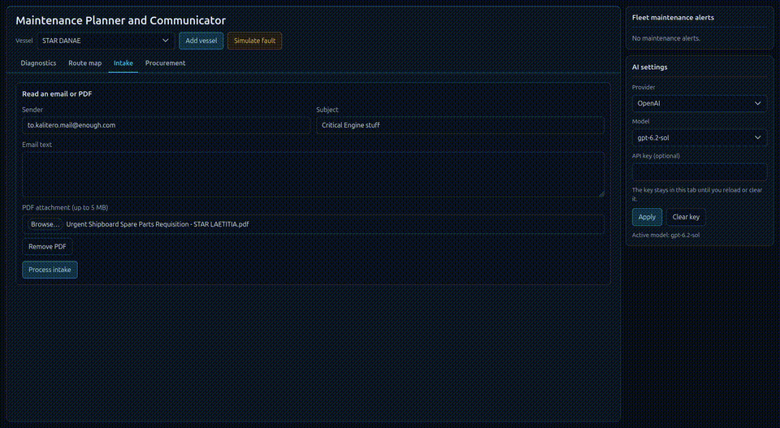
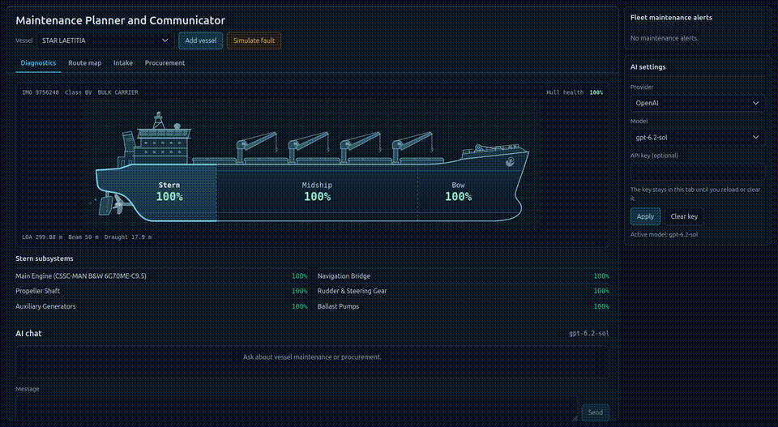
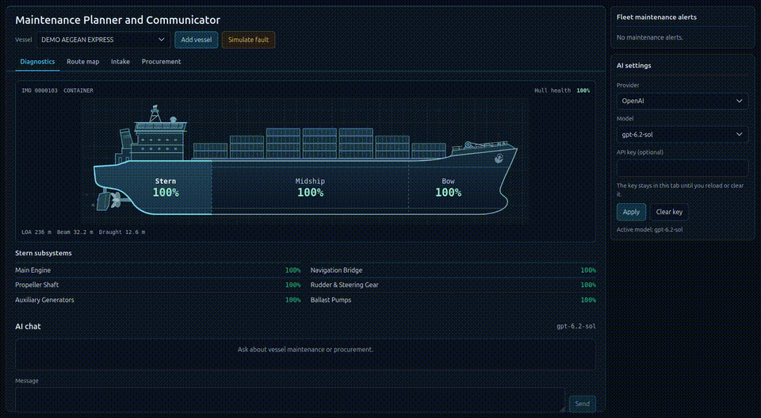
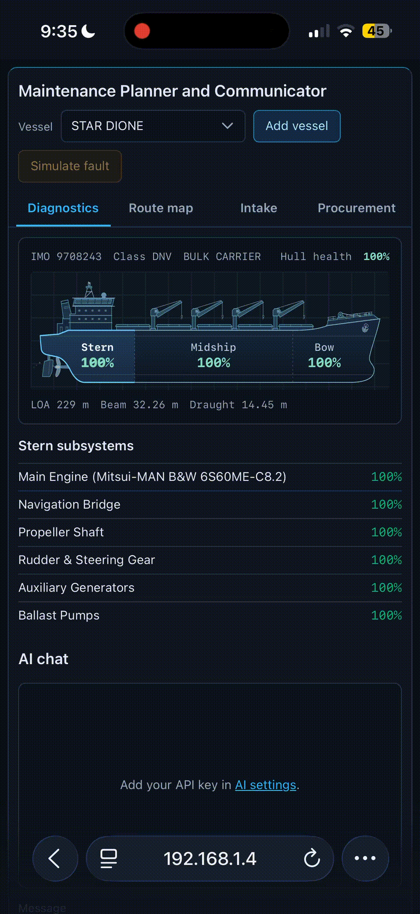

 ### The Problem

All maritime corporations suffer from a basic worldwide problem: too many levels of communication.

 ### Our Solution

 The **M.P.C.** (short for: Maintance Planner and Communicator) is a software run directly in the web browser for maritime corporations. Its main purpose is for keeping track with a vessel's condition by communicating with the ship's mechanical team, at the same time it communicates with the partnered suppliers to order spare parts. Then it plans the most efficient route to a port for repairs.

 
 

 ## Features 
 
 - Keeping a general ship condition with real time health percentage for each part of the ship.
 - Automatically receiving and sending emails to communicate with each ship's mechanical team, part suppliers and ports.
 - Uses HITL (Human-in-the-loop) so the user/team can approve and edit the draft emails.
 - Tracking each vessel's position on the global map.

 

 ## Tech Stack

 - Programming Languages: 
   - TypeScript
   - CSS
   - Python
 - Frameworks:
   - React -> frontend
   - Express.js -> backend
   - FastAPI -> Python document-reader service

 


## Download and Run

### Setup via-docker
Make sure Git and Docker Compose are installed. Clone the repository and start the project from its root directory

```sh
git clone https://github.com/nikaTSG/MPC.git
cd MPC
sudo docker compose up --build
```
<p align="center">
  
</p>

### Other ways to install
Clone the repository and install the frontend and backend dependencies:

```sh
git clone https://github.com/nikaTSG/MPC.git
cd MPC
npm --prefix server install
npm --prefix client install
```

These commands install TypeScript and the project tooling; a separate global TypeScript installation is not needed.

Set up the Python environment used for PDF and email document reading.

On macOS or Linux:

```sh
python3 -m venv server/.venv.local
server/.venv.local/bin/python -m pip install -r server/src/integrations/ai/requirements.txt
```

On Windows PowerShell:

```powershell
py -3 -m venv server\.venv.local
server\.venv.local\Scripts\python.exe -m pip install -r server\src\integrations\ai\requirements.txt
```

### Start MPC

From the repository root, run:

```sh
npm --prefix client run dev
```

This starts both the web app and API server. Open [http://localhost:5173](http://localhost:5173) in your browser. The demo database is initialized automatically when the server starts.

To use AI features, enter an API key in the dashboard's AI settings. Supplier email uses a demo inbox by default; configure SMTP settings in `server/.env` to send through your own mail server.

## Tutorial 
